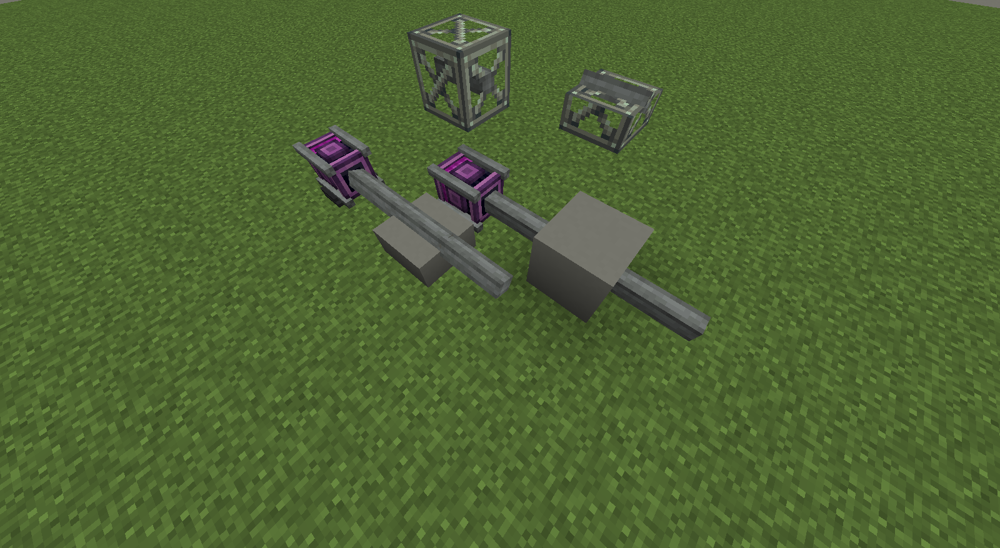

# Copycat Casing

A small addon for [Create](https://modrinth.com/mod/create) on **NeoForge 1.21.1**.

* Encase a shaft in **any full block** The shaft keeps transmitting rotation as normal.

## Requirements

* Minecraft 1.21.1, NeoForge 21.1.219 or newer
* Create 6.0.10 or newer for 1.21.1

## Known limitations

* There is no double slab and no waterlogging.
* Behaviour on moving contraptions has not been tested thoroughly.
* Only the stored block's default state is used, so orientation of logs etc. is not copied.

## License

*CC BY 4.0* 

